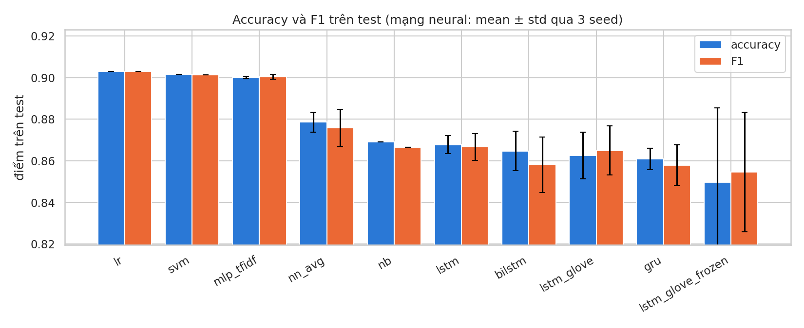
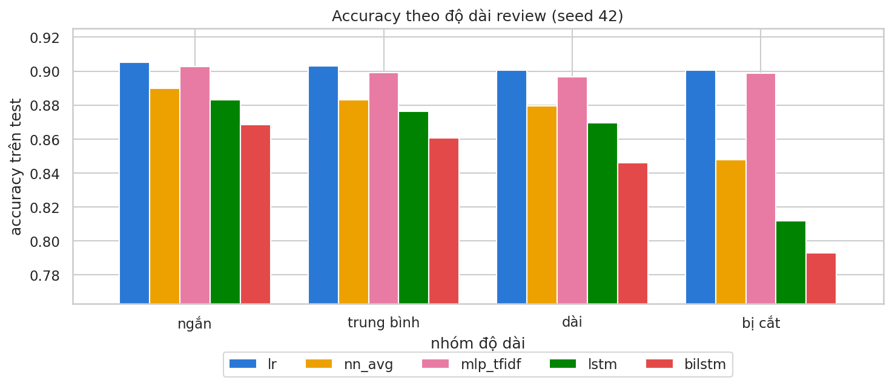

# Phân tích cảm xúc review phim IMDB bằng LSTM

Bài tập phân loại review phim IMDB thành positive hoặc negative. Mô hình chính là LSTM, bên cạnh đó có thêm GRU, BiLSTM và LSTM dùng GloVe. Tất cả được đem so với mạng neural cơ bản và vài phương pháp học máy quen thuộc như Logistic Regression, SVM, Naive Bayes. Câu hỏi muốn trả lời là: đọc được thứ tự từ như LSTM có giúp phân loại tốt hơn so với chỉ đếm từ không?

Mọi mô hình đều train trên cùng 20.000 review, tune trên 5.000 review validation và chấm điểm một lần trên 25.000 review test của bộ IMDB. Toàn bộ code và phân tích nằm trong notebook [`imdb_sentiment.ipynb`](imdb_sentiment.ipynb).


## Kết quả

Mạng neural được chạy 3 lần với 3 seed khác nhau nên có thêm độ lệch chuẩn, còn mô hình học máy chỉ cần chạy một lần. Học máy train trên CPU, mạng neural train trên GPU T4 của Kaggle.

| Mô hình | Nhóm | Accuracy | F1 | ROC-AUC | Train (s) | Số tham số |
|---|---|---|---|---|---|---|
| Logistic Regression (`lr`) | Học máy | **0.9031** | **0.9031** | **0.9653** | 2.7 | 100.001 |
| Linear SVM (`svm`) | Học máy | 0.9015 | 0.9014 | 0.9645 | 0.7 | 100.001 |
| MLP trên TF-IDF (`mlp_tfidf`) | NN cơ bản | 0.9001 ± 0.0006 | 0.9005 ± 0.0012 | 0.9643 ± 0.0001 | 17.4 | 2.560.257 |
| Embedding + AvgPool (`nn_avg`) | NN cơ bản | 0.8786 ± 0.0048 | 0.8758 ± 0.0089 | 0.9515 ± 0.0004 | 13.3 | 2.564.161 |
| Naive Bayes (`nb`) | Học máy | 0.8692 | 0.8665 | 0.9431 | 0.0 | 200.002 |
| LSTM (`lstm`) | Hồi quy | 0.8678 ± 0.0043 | 0.8667 ± 0.0064 | 0.9392 ± 0.0013 | 27.3 | 2.609.473 |
| BiLSTM (`bilstm`) | Hồi quy | 0.8647 ± 0.0095 | 0.8580 ± 0.0133 | 0.9419 ± 0.0042 | 41.5 | 2.601.281 |
| LSTM + GloVe học tiếp (`lstm_glove`) | Hồi quy | 0.8625 ± 0.0113 | 0.8649 ± 0.0118 | 0.9369 ± 0.0114 | 44.6 | 2.042.305 |
| GRU (`gru`) | Hồi quy | 0.8610 ± 0.0052 | 0.8578 ± 0.0099 | 0.9359 ± 0.0018 | 27.1 | 2.597.313 |
| LSTM + GloVe đóng băng (`lstm_glove_frozen`) | Hồi quy | 0.8496 ± 0.0359 | 0.8546 ± 0.0287 | 0.9251 ± 0.0276 | 70.5 | 2.042.305 |

Kết quả của từng seed nằm trong [`results/results.csv`](results/results.csv), các hình nằm trong [`results/figures/`](results/figures/).





## Rút ra

Kết quả khá bất ngờ: mô hình đơn giản nhất lại tốt nhất. Logistic Regression trên TF-IDF đạt 90,3%, còn LSTM chỉ được khoảng 86,8%. GRU, BiLSTM hay dùng thêm GloVe cũng không khá hơn, đều quanh mức 85–87%.

LSTM thậm chí còn thua `nn_avg`, một mô hình chỉ lấy trung bình vector các từ và không biết gì về thứ tự, dù hai mô hình dùng chung mọi thứ khác. Thử xáo trộn hết thứ tự từ trong review thì LSTM chỉ giảm 0,5 điểm, nghĩa là với 20.000 review nó gần như chưa dùng tới thứ tự từ. Nhìn learning curves thì LSTM cũng bắt đầu overfit chỉ sau 1–2 epoch. Với review dài bị cắt bớt, LSTM tụt xuống còn khoảng 81%, trong khi Logistic Regression vẫn giữ được 90% vì TF-IDF nhìn thấy cả review.

Về chi phí, LSTM train lâu hơn Logistic Regression khoảng 10 lần dù đã chạy trên GPU, số tham số cũng nhiều hơn khoảng 26 lần, vậy mà accuracy lại thấp hơn. Với bộ dữ liệu cỡ này, TF-IDF kết hợp một mô hình tuyến tính vẫn là lựa chọn hợp lý nhất.

## Cách chạy

Mở notebook bằng nút Open in Kaggle ở trên, hoặc vào Kaggle tạo notebook mới rồi chọn File → Import Notebook. Trong Settings, chọn GPU T4 và bật Internet. Nếu muốn nhanh hơn ở phần GloVe thì Add Input dataset `glove-global-vectors-for-word-representation`, không có thì notebook tự tải về. Sau đó Run All, cả notebook chạy mất khoảng một tiếng.

## Cấu trúc repo

```
imdb-sentiment-analysis/
├── README.md
├── imdb_sentiment.ipynb   # notebook chính, kèm output
├── requirements.txt
└── results/
    ├── results.csv        # kết quả từng mô hình, từng seed
    ├── summary.csv        # bảng tổng hợp
    └── figures/           # các hình trong notebook
```
